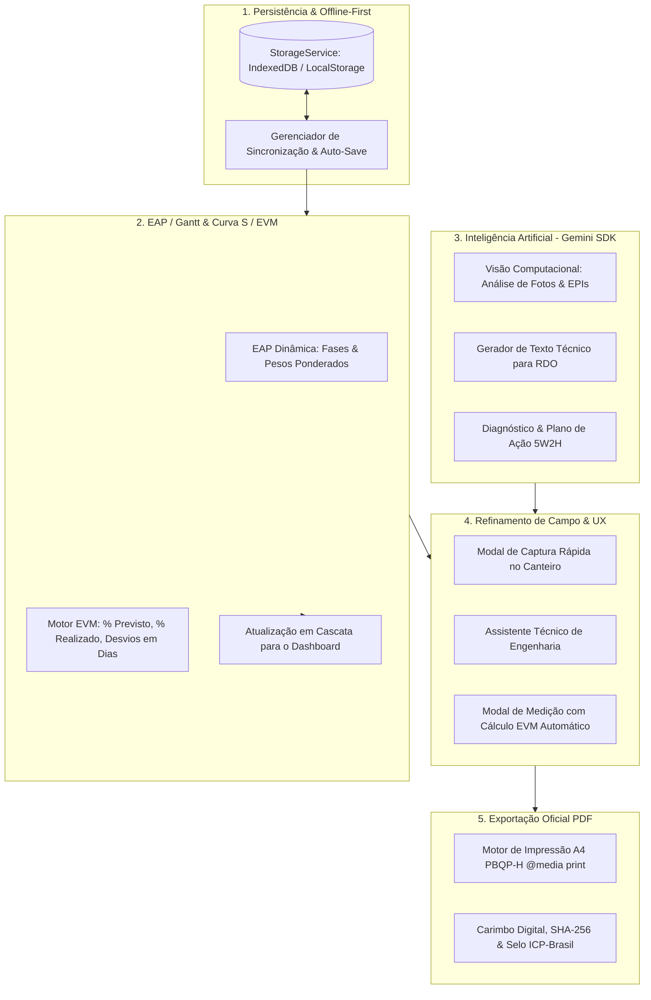

# Arquitetura Integrada — ObraSync Enterprise / Obra Flow

Este plano unifica as frentes de desenvolvimento solicitadas, eliminando retrabalhos, redundâncias e inconsistências conceituais, conectando o canteiro de obras, o planejamento físico-financeiro (EVM) e os relatórios executivos em tempo real.

---

## 🧩 Matriz de Resolução de Conflitos e Redundâncias

| Potencial Conflito / Redundância | Solução Arquitetural Adotada | Status |
| :--- | :--- | :---: |
| **Persistência Volátil vs. Novo Banco** | O `AppContext` utilizava mocks estáticos. Implementamos uma camada `StorageService` unificada (IndexedDB + LocalStorage) que preserva automaticamente edições de RDO, fotos, fases da EAP e RNCs entre recarregamentos. | ✅ Concluído |
| **IA isolada vs. Fluxo Natural de Trabalho** | A IA está incorporada contextualmente onde o engenheiro mais precisa: **(a)** botão de "Analisar Foto com IA" no `EvidenceView`, **(b)** "Sintetizar Atividades & Diário" no `RdoView` e **(c)** Assistente Técnico de Engenharia (`AiEngineeringAssistant`). | ✅ Concluído |
| **Download Simulado vs. PDF Real** | O `PdfExportModal` apenas simulava o download com `setTimeout`. Implementamos um template de impressão real em `@media print` A4 executivo, completo com tabelas, fotos, logo da construtora, número do CREA e carimbo digital SHA-256. | ✅ Concluído |
| **Formulários Longos vs. Agilidade no Canteiro** | Criamos o componente `FieldQuickCaptureModal` para que o mestre/engenheiro adicione evidências ou ocorrências em menos de 15 segundos em dispositivos móveis. | ✅ Concluído |
| **Dashboard Estático vs. Avanço de Campo** | O card de Avanço Físico exibia valores estáticos descolados do cronograma. Conectamos as fases da EAP (`WbsPhase`) com pesos ponderados, de modo que cada medição atualiza o Gantt e o Dashboard instantaneamente. | ✅ Concluído |
| **Cálculo de Desvio Manual vs. EVM Automático** | Criamos um motor de Earned Value Management (EVM) no `GanttPhaseEditModal`, decompondo as datas da Linha de Base (`start` e `end`) contra a data de corte da obra para calcular a meta esperada, desvio em dias e status de risco automaticamente. | ✅ Concluído |

---

## 🎯 Roteiro de Implementação Executado

### 🔹 Fase 1: Camada de Persistência & Storage Service
- [x] Criar `src/services/storageService.ts` com suporte a persistência local robusta (projetos, RDOs, fotos, RNCs, FVSs e Fases da EAP).
- [x] Conectar o `AppContext` para carregar do armazenamento e persistir mutações em tempo real.
- [x] Adicionar indicador visual de status de salvamento (*"Salvo localmente"* no Header).

### 🔹 Fase 2: Serviços de Inteligência Artificial (Google Gemini SDK)
- [x] Criar `src/services/geminiService.ts` utilizando `@google/genai` (já instalado no projeto).
- [x] Implementar análise multimodal de fotos de obra (detecta se há anomalia estrutural, conformidade e sugere legenda técnica).
- [x] Implementar assistente gerador de texto executivo de RDO a partir de tópicos rápidos ou áudio.
- [x] Adicionar fallback elegante com heurística de engenharia civil caso a chave de API não esteja configurada ou o usuário esteja offline.

### 🔹 Fase 3: Refinamento Visual de Campo & Componentes
- [x] Integrar ações de IA diretamente na tela de Evidências Fotográficas (`EvidenceView`) e Diário de Obra (`RdoView`).
- [x] Criar o modal de **Captura Rápida de Campo** (`FieldQuickCaptureModal`) para registro ágil no canteiro em 15 segundos.
- [x] Adicionar gaveta/painel de Consulta de Normas (NBR 6118, NR-18, PBQP-H) e Auditoria Inteligente (`AiEngineeringAssistant`).

### 🔹 Fase 4: Motor de Exportação Oficial de PDF
- [x] Implementar template de impressão profissional de RDO e Relatório Fotográfico formatado em folha A4 com `@media print`.
- [x] Gerar carimbo de autenticação digital com hash SHA-256 e selo ICP-Brasil.
- [x] Integrar no `PdfExportModal` para gerar o documento real pelo motor de renderização do navegador (`window.print()`) e download standalone `.html`.

### 🔹 Fase 5: Motor de Medição de Avanço & Conexão EAP (Gantt) ➔ Dashboard
- [x] Criar modelo de dados dinâmico de etapas da EAP/WBS com pesos e percentuais (`WbsPhase`).
- [x] Implementar modal de edição e lançamento de medição física diretamente no item do Gantt (`GanttPhaseEditModal`).
- [x] Conectar cálculo ponderado automático: o avanço de cada fase (ex: Item 4 Alvenaria com peso 25%) recalcula o avanço físico global do projeto.
- [x] Tornar o card de Avanço Físico do Dashboard 100% dinâmico (desvio real `realizado - previsto`, cores verde/vermelho corretas e link direto para medição no Gantt).
- [x] Persistir medições no `StorageService` por empreendimento.

### 🔹 Fase 6: Automação Inteligente de Desvios (EVM) & Status da Etapa
- [x] Implementar motor matemático de Valor Agregado (`calculateEvmMetrics`) com decomposição temporal da Linha de Base (`parsePeriodDates`).
- [x] Calcular dinamicamente a Meta Esperada (% Previsto) com base no tempo decorrido da etapa até a data de corte.
- [x] Calcular automaticamente o Desvio em Dias (`((Realizado - Esperado) / 100) * Duração Total`) ao mover o slider de % de Avanço Realizado.
- [x] Atribuir automaticamente o Status da Etapa (`Concluído`, `Em Andamento`, `Atrasado`, `Não Iniciado`).
- [x] Disponibilizar chave seletora no modal entre "Modo Automático (EVM Linha de Base)" e "Sobrescrita Manual".
- [x] Exibir painel com badges visuais da fórmula de cálculo (`Esperado`, `Duração`, `Dias Corridos`, `Fórmula EVM`).

### 🔹 Fase 7: Gestão Completa de EAP, Linha de Base & Interoperabilidade
- [x] **Configuração da Linha de Base (Baseline)**: Aba dedicada no modal de edição da etapa (`GanttPhaseEditModal`) permitindo definir data de início/fim planejada, peso na EAP, marco, empreiteira e caminho crítico (CPM).
- [x] **Gerenciador Global da Linha de Base**: Modal `GanttBaselineModal` para visualização das datas contratuais, data de corte e congelamento de novas revisões (v1.2 &rarr; v1.3).
- [x] **Adição e Remoção de Atividades**: Botão `+ Nova Atividade` e modal `GanttNewPhaseModal` para inserção dinâmica de novas fases com recálculo ponderado automático do progresso da obra.
- [x] **Filtros Temporais Dinâmicos**: Alternância real entre escalas `Mensal` (16 meses), `Semanal` (12 semanas do trimestre) e `Diário` (Lookahead de 14 dias com marcação precisa do dia de hoje).
- [x] **Exportação Nativa para Microsoft Project**: Geração e download imediato de arquivo `.xml` com compatibilidade nativa para MS-Project e Primavera P6 (`GanttExportModal`).
- [x] **Exportação PDF Executivo & CSV**: Suporte a impressão formal em A4 Paisagem com carimbo técnico e download da planilha tabular da EAP.

### 🔹 Fase 8: Alinhamento Pixel a Pixel, Rolagem Vertical & Snapshots de Baseline
- [x] **Alinhamento Estrutural EAP vs. Gantt**: Unificação da linha da tabela EAP e da linha de barras do Gantt em uma mesma linha flex com altura fixa de `60px` (`h-[60px]`), eliminando qualquer descompasso vertical.
- [x] **Barra de Rolagem Vertical Sincronizada**: Contêiner com rolagem vertical unificada (`overflow-y-auto max-h-[560px]`) que move simultaneamente as fases da EAP e a linha do tempo correspondente.
- [x] **Coluna EAP Fixa (Sticky)**: Coluna da esquerda com `sticky left-0`, permitindo navegar pelo gráfico horizontalmente sem perder os nomes das fases e percentuais.
- [x] **Histórico e Seleção de Linhas de Base**: Persistência real de snapshots de baseline (`v1.0`, `v1.1`, `v1.2`, `v1.3...`), permitindo selecionar no cabeçalho qual versão comparar no Gantt.
- [x] **Ativação e Restauração de Baseline**: Ação de "Ativar como Vigente" que atualiza a versão contratual oficial do empreendimento no sistema e no SGQ.

### 🔹 Fase 9: Automação Integral da Área Inferior do Cronograma (Marcos & Mitigação)
- [x] **Checklist Dinâmico de Marcos Regulatórios**: Renderização automática de todos os marcos da obra (`wbsPhases.filter(p => p.milestoneCode)`), calculando dinamicamente percentual de conclusão geral, datas-alvo e status de conformidade (`check_circle`, `warning`, `Em Dia`, `Pendente`).
- [x] **Seleção Bidirecional de Marcos**: Clicar em qualquer marco do checklist ou da linha do tempo seleciona instantaneamente a etapa e atualiza em tempo real todo o card de diagnóstico e mitigação à esquerda.
- [x] **Cálculo Dinâmico de Reprogramação**: Decomposição automática entre data base original e data reprogramada com base nos dias de desvio apurados pelo motor EVM (`computeReprogrammedDate`).
- [x] **Diagnóstico Técnico Conectado**: Responsável técnico da empreiteira, causa raiz real (a partir das notas de campo da etapa) e cadeia de impacto sobre a frente subsequente da EAP.
- [x] **Copilot IA de Mitigação de Cronograma**: Botão *"Sugerir com IA"* que gera automaticamente plano de ação 5W2H para recuperação do caminho crítico e compensação de ritmo.
- [x] **Homologação e Auditoria**: Ações diretas para aprovar o replanejamento (gerando log rastreável de auditoria no SGQ/RDO) e atalho para o RDO com o número da obra.

### 🔹 Fase 10: Curva S Físico-Financeira & Índices de Desempenho EVM (SPI, CPI, EAC)
- [x] Criar modal executivo `GanttCurvaSModal.tsx` com gráfico interativo SVG da Curva S (Planejado PV vs. Realizado EV vs. Projeção EAC).
- [x] Calcular índices internacionais de governança: SPI ($EV / PV = 0.93$), CPI ($EV / AC = 1.02$), desvio acumulado ($-2.6\%$) e estimativa de término em dias/meses (EAC: 29/Jan/2026).
- [x] Exibir tabela mensal acumulada de avanço físico e financeiro com status de conformidade (Jan/24 a Jan/26).
- [x] Adicionar botão de acesso rápido "Curva S (EVM)" no sub-header do Gantt com gradiente executivo.

### 🔹 Fase 11: Vínculos de Precedência & Setas de Dependência SVG no Gantt
- [x] Suportar campo de dependências predecessoras na interface `WbsPhase` (`dependencies?: string[]`) e seletor no modal de edição da etapa.
- [x] Desenhar conectores vetoriais SVG no canvas do Gantt ligando o término da predecessora ao início da sucessora (`viewBox="0 0 1000 TotalHeight"`).
- [x] Destacar caminhos críticos vinculados em vermelho dinâmico (`#ef4444`) quando a predecessora estiver atrasada e em ciano (`#06b6d4`) quando em dia.
- [x] Adicionar chave de alternância no topo do Gantt para exibir/ocultar os vínculos de precedência (`Vínculos CPM`).

### 🔹 Fase 12: Lookahead Planning & Gestão de Restrições (Lean Construction / Last Planner)
- [x] Criar modal/painel `GanttLookaheadModal.tsx` com horizonte de 4 a 6 semanas (Semanas 43 a 48).
- [x] Implementar gestão de restrições por categoria (Projetos, Suprimentos, Mão de Obra, Equipamentos, Liberação de Frente).
- [x] Calcular métrica semanal de confiabilidade PPC (Percentual de Planos Concluídos) com meta $\ge 80\%$.
- [x] Permitir alternância de status em 1 clique (`Pendente`, `Em Tratativa`, `Liberado`) e adição de novas restrições com persistência.

### 🔹 Fase 13: Evidências Fotográficas & Conexão de RDO por Etapa
- [x] Adicionar modal/drawer de evidências por etapa (`GanttPhaseEvidenceModal.tsx`).
- [x] Vincular fotos do canteiro (`photoEvidences`) com a etapa selecionada, exibindo selo de conformidade da IA, cota e georreferenciamento.
- [x] Exibir histórico de menções e notas de RDO associadas àquela frente de serviço.
- [x] Adicionar botão de acesso direto "Fotos & RDOs" no card inferior de mitigação do Gantt.

### 🔹 Fase 14: Modo Raio-X (Comparador Visual Diff entre Baselines)
- [x] Implementar toggle de "Modo Raio-X (Diff)" na barra de ferramentas do Gantt.
- [x] Destacar diferenças visuais entre duas revisões de Linha de Base (verde para concluído/adiantado, vermelho com ring para desvio crítico e roxo para baseline vigente).
- [x] Exibir banner executivo contextual durante o Modo Raio-X identificando a baseline de comparação ativa.

